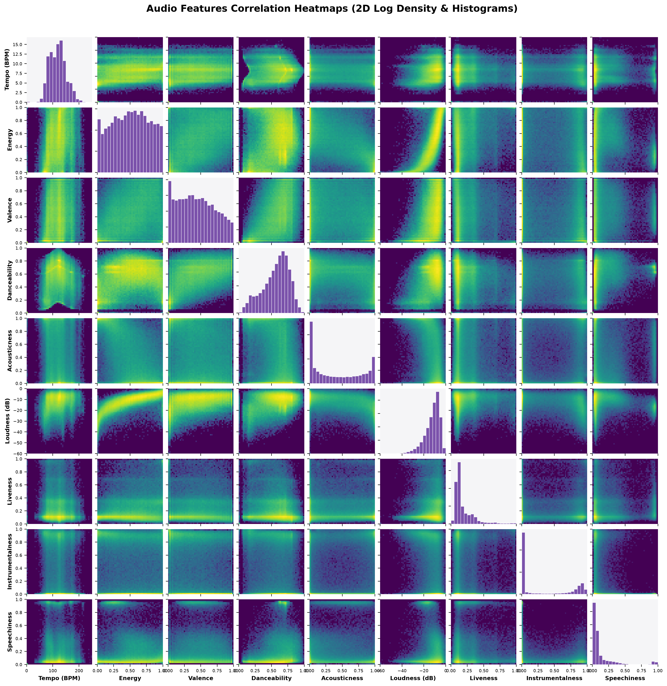

# 🎵 Spotify Metadata Data Pipeline (End-to-End Data Engineering)

An end-to-end, containerized **Data Engineering** pipeline designed to ingest, process, model, and analyze the complete **Spotify Metadata Archive** (~256M tracks, 15.43M artists, 58.6M albums, and 1.7B playlist-track records).

The architecture supports a **dual-track workflow**—a lightweight **Local Development Track** (PostgreSQL + curated dev subset) and a **Cloud Production Track** (GCS + BigQuery)—fully orchestrated with **Kestra**, provisioned via **Terraform**, processed at scale with **Apache Spark (PySpark)**, and modeled for Business Intelligence replication.

---

## 📐 Architecture Overview

                           ┌──────────────────────────────────────────┐
                           │   Kaggle / Anna's Archive (256M Tracks)  │
                           └────────────────────┬─────────────────────┘
                                                │
                           (Flow 01: Incremental Sync via uv & Python)
                                                ▼
                           ┌──────────────────────────────────────────┐
                           │    Google Cloud Storage (Data Lake)      │
                           │    gs://spotify-datalake-.../raw/        │
                           └──────────┬────────────────────┬──────────┘
                                      │                    │
           ┌──────────────────────────┘                    └────────────────────────────┐
           ▼ (Local Dev Track: Flow 02 Local)                                           ▼ (Cloud Prod Track: Flow 02 GCS)
    ┌─────────────────────────────────────────┐                             ┌───────────────────────────────────────────┐
    │   PySpark (Curated Dev Dataset Subset)  │                             │   PySpark 3.5.3 + Hadoop GCS Connector    │
    └────────────────────┬────────────────────┘                             └─────────────────────┬─────────────────────┘
                         ▼                                                                        ▼
    ┌─────────────────────────────────────────┐                             ┌───────────────────────────────────────────┐
    │  PostgreSQL 18 (Indexed Star Schema)    │                             │  Google BigQuery: spotify_data_raw        │
    │  • 15 Normalized Tables + PKs & Indexes │                             │  • 15 Star Schema Tables (Full Catalog)   │
    └─────────────────────────────────────────┘                             └─────────────────────┬─────────────────────┘
                                                                                                  │
                                                                            (Flow 03: Parallel BigQuery SQL + Matplotlib)
                                                                                                  ▼
                                                                            ┌───────────────────────────────────────────┐
                                                                            │  Google BigQuery: spotify_data_marts      │
                                                                            │  • 13 Pre-aggregated Analytical Marts     │
                                                                            └─────────────────────┬─────────────────────┘
                                                                                                  │
                                                                                                  ▼
                                                                            ┌───────────────────────────────────────────┐
                                                                            │  Looker Studio BI & 9x9 Audio Heatmap     │
                                                                            └───────────────────────────────────────────┘

---

## 🛠️ Tech Stack & Infrastructure

* **Orchestration:** [Kestra v1.1](https://kestra.io/) (Dockerized standalone server with PostgreSQL 18 backend & Docker task runner).
* **Infrastructure as Code (IaC):** [Terraform](https://www.terraform.io/) (GCP Storage Bucket with lifecycle policies, BigQuery datasets, and Service Account impersonation).
* **Distributed Processing:** [Apache Spark / PySpark 3.5.3](https://spark.apache.org/) with Google Hadoop GCS Connector (`2.2.5`) and Spark BigQuery Connector (`0.35.0`).
* **Cloud Data Platform:** Google Cloud Storage (Data Lake) & Google BigQuery (Data Warehouse & Analytical Marts, `EU` multi-region).
* **Local Dev Environment:** PostgreSQL 18, pgAdmin 4, and a referentially intact developer dataset subset published on Kaggle.
* **Visualization & Analytics:** Looker Studio & Python (`Matplotlib`, `NumPy`, `Pandas`) for 2D log-density correlation matrices.

---

## 📂 Repository Structure

    spotify-data-pipeline/
    ├── assets/
    │   └── audio_features_correlation_matrix.png                # 9x9 2D Log-Density & Histogram output
    ├── kestra/
    │   └── flows/
    │       ├── main_company.team.00_gcp_kv_setup.yaml           # Centralized GCP & Postgres KV Store configuration
    │       ├── main_company.team.01_spotify_ingest.yaml         # Incremental Kaggle-to-GCS ingestion (byte-size validation)
    │       ├── main_company.team.02_spotify_process_local.yaml  # Local Dev PySpark ETL -> PostgreSQL + PKs/Indexes
    │       ├── main_company.team.02_spotify_process_gcs.yaml    # Cloud Prod PySpark ETL -> BigQuery Raw (Full 256M catalog)
    │       ├── main_company.team.03_spotify_bigquery_marts.yaml # Parallel BigQuery Analytical Marts + 9x9 Heatmap
    │       └── main_company.team.04_spotify_full_pipeline.yaml  # End-to-End Master Orchestrator (Subflow chaining)
    ├── scripts/
    │   ├── lib/
    │   │   └── gcs-connector-hadoop3-2.2.5.jar                  # Official Google Cloud Storage connector for Hadoop 3
    │   ├── create_dev_dataset.py                                # Referential-integrity subset builder (Popularity >= 30)
    │   ├── ingest_to_gcs.py                                     # Idempotent Kaggle-to-GCS sync script
    │   ├── process_data_local.py                                # Local PySpark Star Schema loader (PostgreSQL)
    │   ├── process_data_jetson.py                               # Memory-tuned full-catalog loader (PostgreSQL on Edge/Jetson)
    │   ├── process_data_gcs.py                                  # Distributed PySpark Star Schema loader (BigQuery)
    │   └── plot_audio_correlations.py                           # 9x9 2D Log-Density & Histogram matrix generator
    ├── terraform/
    │   ├── main.tf                                              # GCS Data Lake & BigQuery dataset provisioning
    │   └── variables.tf                                         # Configurable GCP project, bucket, and region variables
    ├── docker-compose.yml                                       # Kestra, PostgreSQL 18, and pgAdmin stack
    └── README.md

---

## 🗄️ Data Modeling

### 1. Raw Warehouse Layer (`spotify_data_raw`)
Raw Parquet and JSON files are transformed via PySpark into a **15-table Star Schema** using deterministic MD5-based UUIDs derived from source `rowid` keys to guarantee cross-table referential integrity:

* **Dimensions (6):** `dim_tracks`, `dim_albums`, `dim_artists`, `dim_playlists`, `dim_markets`, `dim_artist_redirects`
* **Facts (3):** `fact_track_audio_features`, `fact_track_files`, `fact_playlist_tracks`
* **Bridges (3):** `bridge_track_artists`, `bridge_artist_albums`, `bridge_artist_genres`
* **Satellites (3):** `sat_artist_images`, `sat_album_images`, `sat_playlist_images`

### 2. Analytical Marts Layer (`spotify_data_marts`)
Orchestrated in parallel by Kestra (`03_spotify_bigquery_marts`), these 13 pre-aggregated tables power sub-second BI dashboards and replicate the statistical findings of the original Spotify archive study:

| Mart Table | Analytical Purpose & BI Visualization |
| :--- | :--- |
| `mart_tracks_popularity` | Track count distribution across popularity scores (`0–100`) for linear and log-scale plots. |
| `mart_artists_popularity` | Artist count distribution across popularity scores (`0–100`, log scale). |
| `mart_archive_coverage_by_pop` | Preservation coverage breakdown (`Archived`, `ISRC Copy Archived`, `Not Archived`) by popularity. |
| `mart_tracks_duration` | Track length distribution (`5s` buckets for `<10 min`; `1m` buckets up to `5h+` for long tracks). |
| `mart_tracks_content_rating` | Catalog split between `Explicit` and `Clean` tracks. |
| `mart_isrc_duplicates` | Recording duplication frequency (`1` to `100+` track IDs sharing the same ISRC). |
| `mart_upc_duplicates` | Album release duplication frequency (`1` to `N` album IDs sharing the same UPC). |
| `mart_markets_availability` | Top 20 vs. Bottom 20 markets ranked by song availability (`popularity >= 10`). |
| `mart_genres_hierarchy` | Top genres (`>500` artists) classified into 18 macro-genres via regex taxonomy rules. |
| `mart_albums_by_year` | Historical album release volume from `<1970` through `2025`. |
| `mart_albums_track_count` | Distribution of album sizes (`1` track singles up to `50+` track compilations). |
| `mart_key_mode_distribution` | Musical pitch class distribution (`C` through `B`) segmented by modality (`Major` vs. `Minor`). |
| `mart_audio_features_sample` | Stratified 250k random sample feeding the 9x9 audio feature correlation heatmap. |

---

### 📊 Audio Features Correlation Matrix (256M Catalog Sample)



## 📦 Developer Dataset Subset (Kaggle)

Processing the full 256M-track dataset requires substantial compute and storage. To make local development and testing accessible, **`scripts/create_dev_dataset.py`** extracts a **referentially intact subset** filtering tracks with `popularity >= 30` and top 50,000 playlists, cascading joins across all 15 dimension, fact, bridge, and satellite tables into clean single-file `.parquet` outputs.

* **Kaggle Dev Dataset:** *(https://www.kaggle.com/datasets/percyvirus/annas-archive-spotify-2025-07-metadata-subset/data)*

---

## 🧩 Engineering Challenges & Solutions

1. **PySpark 4.0 / Hadoop 3.4 Compatibility (`NumberFormatException: "64m"`):**
   * *Challenge:* Modern PySpark builds ship with Hadoop 3.4+, whose `core-default.xml` introduces string unit suffixes (`"64m"`) that break older GCS connectors (`gcs-connector-hadoop3-2.2.5.jar`).
   * *Solution:* Pinned `pyspark==3.5.3` inside the Kestra Docker runner and explicitly initialized the Hadoop filesystem layer via `SparkConf` and `SparkContext`.
2. **Keyless GCP Authentication (`constraints/iam.disableServiceAccountKeyCreation`):**
   * *Challenge:* Organization security policies blocked exporting static Service Account JSON keys, while Hadoop 2.2.5 did not natively support ADC service account impersonation.
   * *Solution:* Configured user Application Default Credentials (`gcloud auth application-default login`), mounted `~/.config/gcloud` read-only into Kestra's Docker containers, and explicitly injected `project` and `parentProject` options into the Spark BigQuery connector.
3. **Container Memory Tuning at Scale (OOM Prevention):**
   * *Challenge:* Running `local[*]` caused Docker Desktop's OOM killer to terminate the JVM during massive `.dropDuplicates()` shuffles on `dim_albums` and `fact_track_files`.
   * *Solution:* Constrained concurrency to `local[2]`, calibrated `spark.driver.memory` to `8g` with `spark.memory.fraction=0.6`, and tuned shuffle partitions (`64`), completing the full 256M-row ingestion cleanly.
4. **BigQuery Partitioning Limits:**
   * *Challenge:* Daily partitioning on historical album release dates (`1900–2026`) exceeded BigQuery's hard ceiling of 4,000 partitions per table.
   * *Solution:* Adopted annual truncation (`DATE_TRUNC(..., YEAR)`) and pre-aggregated analytical marts in `spotify_data_marts`.

---

## 🚀 Getting Started

### Prerequisites
* Docker & Docker Compose
* Python (`>= 3.10`) & [`uv`](https://docs.astral.sh/uv/) (for local PySpark execution and dependency management)
* **Java Runtime / JDK (`11` or `17`)** (required by Apache Spark / PySpark JVM; e.g., `sudo apt install -y openjdk-17-jre-headless`)
* Terraform (`>= 1.5`) *(for Cloud Prod Track)*
* Google Cloud SDK (`gcloud auth application-default login`) *(for Cloud Prod Track)*
* Kaggle API credentials (`KAGGLE_API_TOKEN` in `.env`)

### 1. Provision Cloud Infrastructure

    cd terraform
    terraform init
    terraform apply

### 2. Start Kestra & Local PostgreSQL Stack

    cp .env.example .env  # Add your KAGGLE_API_TOKEN
    docker-compose up -d

Access Kestra UI at `http://localhost:8080` (`admin@kestra.io` / `Admin1234!`) and pgAdmin at `http://localhost:8085`.

### 3. Run the Pipeline
1. **Initialize KV Store:** Execute `00_gcp_kv_setup` in Kestra (`company.team` namespace).
2. **Local Dev Track:** Download the dev dataset subset, run `02_spotify_process_local` to populate PostgreSQL with primary keys and foreign-key indexes.
3. **Full Local / Edge Track (NVIDIA Jetson Orin Nano - 100% Catalog):**
   - Start PostgreSQL (`docker compose up -d spotify_db`), mount the full Parquet archive (e.g., `/mnt/hdd_jetson/datasets/spotify-metadata-by-annas-archive`), and run the memory-tuned loader via `uv`:
     ```bash
     uv sync
     nohup uv run python scripts/process_data_jetson.py > ingest.log 2>&1 &
     ```
3. **Cloud Production Track:** Execute the master orchestrator **`04_spotify_full_pipeline`** (toggling `run_ingestion` and `run_pyspark_etl` as needed) to populate BigQuery Raw, build all 13 Analytical Marts, and generate `scripts/audio_features_correlation_matrix.png`.